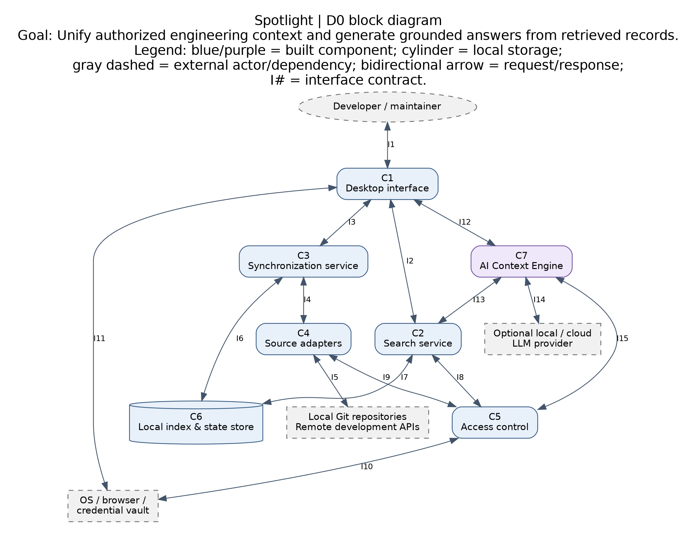
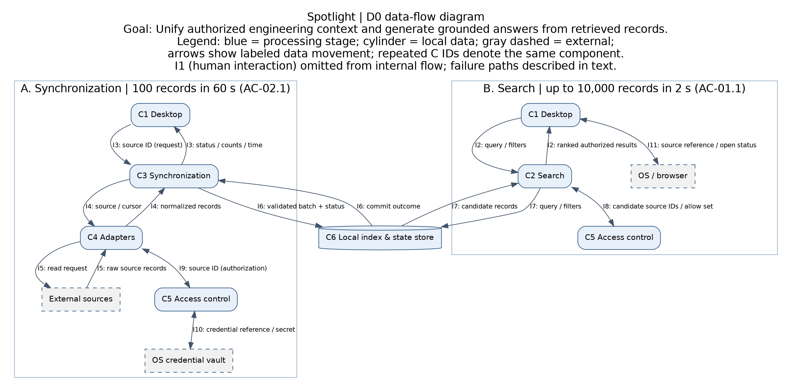
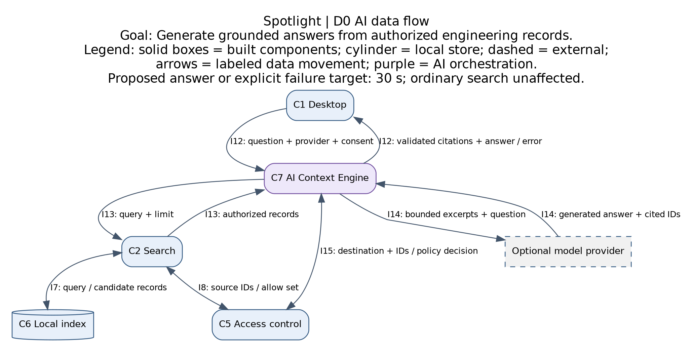

# Spotlight — D0 High-Level System Design
**Team:** Shashwat Mishra, Rohan Shetty
**Advisor:** Dr. Hrishikesh Vinayak Bhide

## 1. Title, goal statement, and conventions

Goal: Unify authorized engineering context and generate grounded answers from retrieved records.

Inputs are authorized local repository records, remote development records, search queries, natural-language questions, and synchronization requests. Outputs are ranked search results with source references, explicit work-item relationships, synchronization status or actionable errors, and optional AI-generated answers with source references.

Scope: single-user prototype on the developer workstation; read-only source integrations; local data by default; optional AI generation; no mandatory cloud processing. Blue solid boxes represent components built by the team, gray dashed shapes represent external dependencies, cylinders represent local storage, and I-numbers identify request/response contracts.

Design status: proposed baseline for team review; timing values are requirements, not measured performance.

## 2. Block diagram (the D0 diagram)



The desktop interface is the only human-facing component. C7 orchestrates retrieval-augmented generation (RAG) using C2 and an optional model provider; it does not train a model or directly access development platforms. Search reads the index; synchronization writes through the store; access control gates source reads and search output. The external source group represents local Git and supported remote development APIs.

## 3. Component responsibility table

| Component | Responsibility | Interfaces in/out | Primary owner | Story trace |
| --- | --- | --- | --- | --- |
| C1 Desktop interface | Collects user requests and presents outcomes. | I1, I2, I3, I11, I12 | Rohan | US-01–04 |
| C2 Search service | Returns ranked, authorized matches and explicit work-item relationships. | I2, I7, I8, I13 | Shashwat | US-01–03, 05 |
| C3 Synchronization service | Coordinates atomic ingestion batches and records their outcomes. | I3, I4, I6 | Shashwat | US-04 |
| C4 Source adapters | Translates source-specific reads into canonical records. | I4, I5, I9 | Shashwat | US-01, 03–05 |
| C5 Access control | Enforces local profile and source authorization using protected credentials. | I8, I9, I10, I15 | Shashwat | US-05 |
| C6 Local index & state store | Persists searchable records, integration metadata and synchronization state. | I6, I7 | Rohan | US-01, 03–05 |
| C7 AI Context Engine | Generates source-grounded answers from authorized retrieved records. | I12, I13, I14, I15 | Shashwat | US-01–03, 05 (extension) |

The owners are proposed task leads, not exclusive developers. Both team members contribute to implementation, documentation and testing.

## 4. Interface specification table

| Interface | Input (name:type) | Output (name:type) | Format / protocol | Error handling / owner |
| --- | --- | --- | --- | --- |
| I1 Actor ↔ C1 | query:string; question:string?; filters:map; sourceId:string; action:enum | results:list; answer:object?; status:object; message:string | Text / structured view; desktop interaction | C1: show input validation or operation error. |
| I2 C1 ↔ C2 | query:string; filters:map; profileId:string | results:Record[]; error:Error? | JSON; local request/response | C2: return INDEX_UNAVAILABLE or invalid query; C1 displays. |
| I3 C1 ↔ C3 | sourceId:string; action:enum(sync/status) | status:enum; count:int; completedAt:timestamp?; error:Error? | JSON; local request/response | C3: report failure and last successful time; C1 displays. |
| I4 C3 ↔ C4 | sourceId:string; cursor:string? | records:Record[]; nextCursor:string?; error:Error? | Typed objects; internal call | C4 maps source failures; C3 aborts uncommitted batch. |
| I5 C4 ↔ external sources | read operation:enum; repo/path:string; cursor:string?; credential:string? | raw records:list; status:int? | Native Git/filesystem read or HTTPS API JSON | C4 handles missing path, 401/403, rate limit, timeout; no source writes. |
| I6 C3 ↔ C6 | batch:Record[]; sourceId:string; status:object; cursor:string? | committed:bool; count:int; error:Error? | Typed objects / indexed rows; local storage transaction | C6 rolls back incomplete record batch; C3 records failed attempt separately. |
| I7 C2 ↔ C6 | query:string; filters:map | candidates:Record[]; error:Error? | Typed objects / indexed rows; local query | C6 reports unavailable index; C2 logs and returns error. |
| I8 C2 ↔ C5 | profileId:string; candidateSourceIds:string[] | allowedSourceIds:string[]; error:Error? | Typed objects; internal call | C5 denies unknown or revoked sources; C2 suppresses denied results. |
| I9 C4 ↔ C5 | profileId:string; sourceId:string; requestedScope:enum(read) | allowed:bool; credential:string?; error:Error? | Typed objects; internal call | C5 denies unapproved scope or missing credential; C4 stops read. |
| I10 C5 ↔ OS vault | profileId:string; credentialRef:string; operation:enum | credential:string?; outcome:enum | Native OS credential interface | C5 fails closed; secrets never included in logs or index. |
| I11 C1 ↔ OS/browser | sourceRef:string; action:enum(open) | opened:bool; error:Error? | URI / local path; OS launch interface | C1 validates allowed URI/path and reports launch failure. |
| I12 C1 ↔ C7 | question:string; profileId:string; providerId:string; consent:bool | answer:string?; citations:string[]; status:enum; error:Error? | JSON; local request/response | C7 returns NO_CONTEXT, AI_DISABLED or MODEL_UNAVAILABLE; C1 preserves ordinary search. |
| I13 C7 ↔ C2 | query:string; profileId:string; limit:int | results:Record[]; error:Error? | Typed objects; internal call | C2 enforces access checks; C7 stops generation on retrieval failure or zero records. |
| I14 C7 ↔ model provider | question:string; context:ContextItem[]; maxOutputTokens:int | answer:string; citedIds:string[]; error:Error? | JSON; local model interface or HTTPS API | C7 handles timeout, rate limit, malformed response; no automatic cloud fallback. |
| I15 C7 ↔ C5 | profileId:string; providerId:string; recordIds:string[]; consent:bool | allowedRecordIds:string[]; allowed:bool; credentialRef:string?; error:Error? | Typed objects; internal call | C5 denies absent consent, unapproved destination, or unverified permissions; C7 sends no denied records. |

ContextItem: {id:string, excerpt:string}. AI output references must resolve to retrieved record IDs; C7 rejects unknown references and treats source text as untrusted data. Provider credentials are protected by C5 via I10; I15 may return a transient provider credential reference resolvable through the approved provider interface for an approved cloud request. No credentials are placed in model context.

Record: {id:string, sourceId:string, type:enum, title:string, body:string, sourceRef:string, updatedAt:timestamp, workItemRefs:string[]}. Error: {code:string, message:string}. A question mark indicates an optional field. The record identity is sourceId + id; credentials are transient and never part of Record.

```json
I2 example request:
{"query":"SPOT-42","filters":{"type":"pull_request"},"profileId":"local"}
I2 example response:
{"results":[{"id":"pr-17","sourceId":"repo-a","type":"pull_request",
"title":"SPOT-42 Fix search","body":"","sourceRef":"https://example.com/pr/17",
"updatedAt":"2026-11-18T14:00:00Z","workItemRefs":["SPOT-42"]}],"error":null}
```

I12 example request (illustrative):

```json
{"question":"Why did search change?","profileId":"local","providerId":"local-model","consent":false}
```

I12 example response:

```json
{"answer":"PR 17 updated search for SPOT-42 [pr-17].","citations":["pr-17"],"status":"ok","error":null}
```

## 5. Data-flow diagram



Search: C2 filters candidates through C5 before returning them to C1. The 2-second budget also applies to zero matches; index errors are logged and displayed within 5 seconds (AC-01.2/3). Source references allow navigation without modifying source records.

Synchronization: normalize and validate records before an atomic upsert; update the successful timestamp only after commit. No-change runs return zero updates; authentication failures stop ingestion and report failure within 5 seconds of the API error, preserving existing records (AC-02.2/3). Denied sources must remain hidden from search until authorization is restored; retained records are not treated as permission to display them.



AI context flow: retrieve up to 10 authorized records through C2, check destination policy with C5, then send only bounded relevant excerpts to the configured model. C7 validates returned citation IDs and maps them to original source references; this verifies reference membership, not factual correctness. If evidence is insufficient, return a no-context response rather than inventing an answer. External processing requires explicit authorization and appropriate repository policy; local generation is the default when configured. No model calls occur for ordinary search. Proposed AI target: answer or explicit failure within 30 seconds after submission for a configured provider; subject to team validation and a new acceptance criterion. Existing search and sync timing budgets remain unchanged. Semantic retrieval is an optional later refinement inside C2/C6; baseline RAG works with keyword retrieval and does not require embeddings.

## 6. Architecture pattern and justification

Primary pattern: layered architecture (desktop presentation, application services, adapters/access control, persistence). A pipeline governs ingestion: read, normalize, validate, commit, report. A local client-server style governs C1 requests to C2/C3/C7; the transport and process boundary remain implementation decisions. RAG is the AI-specific retrieval/generation pipeline, not a replacement for the layered architecture.

| Criterion | Justification |
| --- | --- |
| Fit to problem | Search and synchronization have distinct read/write paths; adapters isolate source-specific formats. Explicit work-item references support US-03; C7 adds contextual summaries without changing source records. |
| Team skills | Two developers can divide UI/storage and backend work while sharing tests; existing full-stack and API experience fits the boundaries; a model adapter avoids training or fine-tuning. |
| Performance and timing | Local search avoids remote calls per query; batched writes and bounded result processing target 2 s for 10,000 records and 60 s for 100 records under normal API conditions; optional AI has a separate 30 s target and never blocks ordinary search. |
| Scalability | Additional sources can implement the same adapter contract; local storage limits the MVP to workstation scale rather than claiming enterprise throughput. Bounded model context limits request size and cost. |
| Hardware constraints | Runs on a developer workstation without dedicated servers; local storage and indexing consume disk and CPU, so incremental synchronization is preferred. Local model inference may require more RAM/CPU; use a suitably sized model or disable AI on unsupported hardware. |

Rejected pattern: independently deployed microservices. They add network failure modes, deployment overhead and recurring hosting costs for a two-person MVP. The layered local design supports the proposed $0 recurring budget, authorized test repositories, least-privilege access and local data retention. The trade-off is extra local storage and permission-management effort. Local inference avoids cloud fees and egress but may be slower on modest hardware; any optional cloud usage must be explicitly authorized and fit the budget.

## 7. Decision log

| ID / decision | Alternatives considered | Rationale |
| --- | --- | --- |
| D0-01 Local-first index | Live federated API queries; hosted central index | Avoid per-query network latency and paid hosting; keep private records local by default. |
| D0-02 Layered local application | Distributed microservices; unstructured single module | Maintain clear boundaries without independent deployments. |
| D0-03 Read-only adapters | Read/write integrations | Reduce scope, permission exposure and unintended source changes. |
| D0-04 Canonical record schema | Source-specific index schemas | Enable cross-source search and explicit issue references with shared fields. |
| D0-05 Atomic incremental synchronization | Full rebuild each run; partial writes on failure | Preserve existing records on failure and avoid duplicates. |
| D0-06 Access checks before retrieval output | Trust cached records indefinitely | Protect confidential engineering data; deny unverified or revoked sources even if cached. |
| D0-07 Retrieval-augmented generation | Fine-tuning; unrestricted chatbot | Ground answers in current indexed context without a training pipeline. |
| D0-08 Optional model provider | Mandatory cloud LLM; mandatory local LLM | Preserve search on low-resource devices, respect privacy and avoid mandatory recurring costs. |
| D0-09 Bounded context and citation validation | Send entire repository; uncited answers | Reduce exposure and token cost; make answers traceable to original records. |

Requirements alignment: US-01–05 remain the committed baseline. C7 is a proposed extension to US-03 (contextual summaries), also supporting US-01/02 and constrained by US-05. Update Assignment 4 with the revised US-03 and a new AI use case/acceptance criteria before assembling the Week 7 packet.

Review before final submission: agree on the component owners, authorization lifetime/revocation policy, supported remote integration, and local transport. These are proposed team decisions, not evidence of implementation or completed tests.