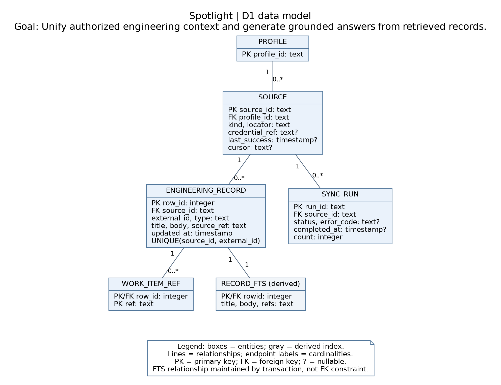

# Spotlight — D1 Detailed System Design

**Team:** Shashwat Mishra, Rohan Shetty  
**Advisor:** Dr. Hrishikesh Vinayak Bhide

## 1. Header, scope, and conventions

**Goal:** Unify authorized engineering context and generate grounded answers from retrieved records.

D1 details C2 Search Service, C6 Local Index and State Store, and C7 AI Context Engine; C1 Desktop Interface, C3 Synchronization Service, C4 Source Adapters and C5 Access Control are deferred to D2. D0 interfaces I2, I6–I8 and I12–I15 retain their existing meanings. This is a proposed implementation design, not a report of measured performance.

The entity diagram uses boxes for entities, solid lines for relationships, endpoint labels for minimum and maximum cardinality, PK for primary keys and FK for foreign keys; a question mark marks nullable fields. The gray box represents the derived full-text index. The diagram includes its own legend.

## 2. Data model (D1 diagram)



SQLite is a relational store on the workstation. Each source belongs to the single local profile; each record belongs to exactly one source. Synchronization runs are separate from records to preserve failure history. All timestamps are UTC RFC 3339 strings. Source authorization is evaluated by C5; a stored source row is not proof of access. Secrets are stored in the OS vault, never in SQLite.

| Structural decision | Rationale and traceability |
|---|---|
| Source is an entity, not a record attribute | One source can own many records and runs; keeps cursor and credential reference in one place (US-04). |
| Unique (source_id, external_id) | Prevent duplicate records during upsert; IDs may overlap across sources (AC-02.1/2). |
| Work item reference is a child entity | A record can mention multiple references; composite key (row_id, ref) prevents duplicate links. References are scoped to the configured project namespace, not globally assumed unique (US-03). |
| Sync run is a separate entity | Failed attempts retain their status without changing last successful timestamp or records (AC-02.3). |
| Full-text index (FTS5) | Index title, body and normalized references for keyword retrieval; rowid maps to the canonical record (US-01). |
| B-tree indexes | Index source_id/type and work_item_ref(ref, row_id), plus sync_run(source_id, completed_at) for filtering, relationship lookup and status history. |
| No AI answer table | Answers are ephemeral for the MVP; source metadata remains local and no extra confidential prompt history is persisted (US-05). |

Record and FTS updates occur in the same transaction over I6; C6 rolls back the entire batch on failure. A successful commit updates cursor and last_success. A failed run is recorded separately without changing the success timestamp. The canonical D0 Record maps external_id to id and returns workItemRefs as an array assembled from child rows. For citation IDs, C7 uses a unique source-qualified identifier, not external_id alone.

## 3. Core algorithms

### A1 — Authorized keyword retrieval and ranking (C2/C6)

**Problem:** Retrieve relevant records across multiple sources within the AC-01.1 two-second target, without exposing unauthorized cached data.

**Inputs:** query: string (1–500 characters after trim); filters: object with optional type and sourceId strings; profileId: string; limit: integer (1–100, default 50). **Outputs:** ranked Record[] and optional Error as in I2; I13 uses the same retrieval with limit 10. Exact work-item identifiers use the normalized reference index as an additional lookup.

**Method:** Validate input and escape FTS operators so user text is treated as literal terms. Ask C5 for allowed source IDs using I8; deny unknown or revoked sources. Query C6 through I7 with both source and type constraints. Use FTS5 BM25 ranking (lower score is better), adding exact reference matches ahead of ordinary text matches; deduplicate by row_id and break ties by updatedAt descending then row_id ascending. Recheck returned source authorization before returning any result. Cap results and allow repeated pages in a later revision; the initial endpoint returns up to the requested limit. Source navigation uses the record's original reference. No LLM call occurs for normal search.

**Complexity:** Let N be indexed records, L the total postings traversed for query terms, M matching candidates and k result limit. An inverted index avoids scanning every body for selective terms; approximation is O(L + M log M) for matching and sorting, or O(L + M log k) if a bounded top-k plan is available. Authorization adds O(M) membership checks with a set of allowed IDs. At N=10,000 and k=50, a broad query could rank all 10,000 matches; at 100x (1,000,000 records), broad matching and storage costs can rise roughly 100x or more with sorting. These are estimates, not SQLite execution guarantees. Benchmark warm and cold queries on a workstation before optimizing.

**Alternatives:** Linear substring scanning is simple but reads each body per query; vector search adds embedding generation, storage and ranking complexity. FTS5 gives exact keyword and identifier retrieval without a model; semantic search remains a later refinement.

**Edge cases:** Empty or malformed query returns INVALID_QUERY; no match returns an empty array within two seconds (AC-01.2); duplicates are collapsed by row_id; equal scores use deterministic order; inaccessible index returns INDEX_UNAVAILABLE and logs a safe error within five seconds (AC-01.3); denied sources produce no results.

### A2 — Bounded retrieval-augmented generation (C7)

**Problem:** Generate contextual answers using evidence from authorized engineering records instead of sending an entire repository or inventing context (US-03 extension; US-05).

**Inputs:** question: string (1–1000 characters), profileId: string, providerId: string, consent: boolean. **Outputs:** answer: string or null; citations: string[] of source-qualified IDs; status: enum(ok, no_context, failed); error: Error or null (I12).

**Method:** Validate the question, set a 30-second overall deadline and check provider configuration. Retrieve up to ten relevant authorized records through I13. If none are relevant, return NO_CONTEXT without model invocation. Use I15 to recheck record permissions and destination policy; cloud requires explicit consent plus repository policy permission. If authorization is denied, stop. Construct a prompt with the question and at most ten excerpts (each up to 800 Unicode characters, total excerpt budget 8,000 characters); treat record text as untrusted evidence, not instructions. Send via I14 with maxOutputTokens=512; reserve time for retrieval and validation within the deadline. Require an answer and citation IDs in structured output. Reject unknown or missing citations for a substantive answer; map valid IDs to source references already held locally. Recheck permission before presenting output. If no sufficient evidence is indicated, return no_context. Citation membership does not prove factual correctness; UI identifies generated text and lets users verify sources. No model gets credentials or tool access.

**Complexity:** Retrieval cost is A1; building and checking context is O(k*b + a) for k<=10 excerpts of b<=800 characters and output length a. At 10,000 records, at most 8,000 excerpt characters are sent; at 1,000,000 records, generation input remains bounded but retrieval may be slower. Model inference cost depends on provider, model, tokenization and hardware, not simply N; the 30-second deadline limits waiting, not guaranteed answer generation.

**Alternatives:** Fine-tuning requires training data and compute and does not guarantee current facts; sending the full repository increases privacy exposure and cost. Keyword RAG is sufficient for the MVP; embeddings may improve recall after evaluation.

**Edge cases:** Empty question returns INVALID_QUERY; duplicate evidence is removed using source-qualified IDs; no relevant authorized records returns NO_CONTEXT; consent denial returns ACCESS_DENIED before egress; timeouts/rate limits/malformed output return MODEL_UNAVAILABLE or INVALID_MODEL_RESPONSE; ordinary search remains available. No automatic switch from local to cloud. Source text may contain prompt injection, so model output is untrusted and cannot trigger actions.

## 4. Build-versus-reuse decisions

| Piece | Build / reuse | Candidate and license | Reason (maturity, performance, fit) |
|---|---|---|---|
| Relational persistence and FTS | Reuse | SQLite / FTS5, public domain | Established embedded database; indexed local reads and transactions fit C6 without a database server. |
| Database driver | Reuse | modernc.org/sqlite, BSD-3-Clause | Pure Go driver avoids separate C toolchain; verify FTS5 and transaction behavior with pinned release and benchmark. |
| Canonical record mapping and atomic batch management | Build | Team code; repository license TBD | Project-specific identity and synchronization semantics; reuse database transactions rather than implement persistence. |
| Search orchestration and authorization | Build | Team code | Combines exact references, source policy and deterministic ranking; reuse FTS5 and Go sorting. |
| HTTP and JSON | Reuse | Go standard library, BSD-3-Clause | Mature HTTP and JSON support; no extra framework required for local service. |
| Local model inference | Reuse | Ollama, MIT (runtime); model weights separately licensed | Local inference via HTTP; avoids training; select a compatible model after checking RAM, license and latency. |
| RAG orchestration and citation checks | Build | Team code | Small bounded workflow with project-specific access rules; no agent framework needed. |
| OS credential access | Reuse | OS credential vault; platform terms apply | Established platform protection; no custom cryptography; adapter details in D2. |

License labels refer to proposed upstream components, not all transitive dependencies. Before implementation, pin versions, inspect their license files and dependency notices, verify FTS5 support in the chosen driver, and check model-weight terms independently. No specific LLM or package version is committed yet.

## 5. API contract

Local HTTP/JSON endpoints served on loopback only, protected with a per-launch random session token passed in the Authorization header. The backend derives the active local profile from that session and rejects mismatching profileId. Requests and successful responses use application/json UTF-8; timestamps are UTC RFC 3339. C1 does not directly access C6 or provider credentials. Internal interfaces use typed Go structs rather than public HTTP routes.

### Common types

- Record = {id: string, sourceId: string, type: enum(commit, pull_request, issue, file), title: string, body: string, sourceRef: string, updatedAt: timestamp, workItemRefs: string[]}.
- Error = {code: string, message: string}. Messages exclude credentials and private record text.
- Filters = {type?: Record.type, sourceId?: string}. An omitted filter means no restriction beyond authorization.
- SearchResponse = {results: Record[], error: Error|null}.
- AIResponse = {answer: string|null, citations: string[], status: enum(ok, no_context, failed), error: Error|null}. Citation strings encode the sourceId and id pair unambiguously (e.g., JSON array encoded as a string); C1 resolves them against authorized source references from retrieved records via search.
- Identifiers are nonempty strings of at most 256 characters; counts are nonnegative integers; all limits refer to record counts. Optional inputs have defaults as stated below.

### Public local endpoints

| Endpoint | Inputs (required unless marked optional) | Success output | Errors (HTTP status / code) |
|---|---|---|---|
| POST /api/v1/search (I2) | query: string 1–500 chars; profileId: string; filters?: Filters (default empty); limit?: int 1–100 (default 50) | 200 SearchResponse; no matches = results: [], error: null | 400 INVALID_QUERY or INVALID_FILTER; 401 UNAUTHENTICATED; 403 ACCESS_DENIED (profile mismatch); 503 INDEX_UNAVAILABLE |
| POST /api/v1/context (I12) | question: string 1–1000 chars; profileId: string; providerId: string; consent: bool | 200 AIResponse; status ok or no_context; for no_context answer null, citations [], error null | 400 INVALID_QUERY or INVALID_PROVIDER; 401 UNAUTHENTICATED; 403 ACCESS_DENIED; 503 AI_DISABLED / MODEL_UNAVAILABLE / INDEX_UNAVAILABLE; 502 INVALID_MODEL_RESPONSE; 504 MODEL_TIMEOUT |

On errors, the search envelope carries an empty results array and non-null error; the AI envelope carries null answer, empty citations, status failed and non-null error. C1 displays the message; it does not retry generation automatically. No matching data is a successful empty response, not an HTTP failure. NO_CONTEXT is represented as status no_context in I12 (D0's named outcome).

### Internal methods and external provider contract

| Interface / method | Typed input | Typed output and errors |
|---|---|---|
| I7 C6.Query | query: string; filters: Filters; allowedSourceIds: string[]; limit: int 1–100 | candidates: Record[]; error: Error? (INDEX_UNAVAILABLE); empty allowed set returns zero records. |
| I8 C5.AuthorizeSources | profileId: string; candidateSourceIds: string[] | allowedSourceIds: string[]; error: Error? (ACCESS_DENIED on policy failure); unknown IDs excluded. |
| I6 C6.CommitBatch | sourceId: string; batch: Record[]; cursor?: string; status: object {runId:string, state: enum(success,failed), completedAt:timestamp, errorCode?:string} | committed: bool; count: int; error: Error? (INVALID_RECORD, STORE_WRITE_FAILED); failed run writes status only, no record changes. |
| I13 C2.Retrieve | query: string 1–1000 chars (internal AI question); profileId: string; limit: int 1–10 | results: Record[]; error: Error? (INDEX_UNAVAILABLE, ACCESS_DENIED); long questions normalized to search terms. |
| I15 C5.AuthorizeContext | profileId: string; providerId: string; recordIds: string[] (max 10); consent: bool | allowedRecordIds: string[]; allowed: bool; credentialRef: string?; error: Error? (ACCESS_DENIED); C7 aborts if any requested ID is denied. |
| I14 Provider.Generate | question: string; context: ContextItem[] (1–10, each {id:string, excerpt:string <=800 chars}); maxOutputTokens: int 1–512; deadline: remaining duration in ms | answer: string; citedIds: string[]; error: Error? (MODEL_TIMEOUT, MODEL_UNAVAILABLE, INVALID_MODEL_RESPONSE); adapter translates provider-specific JSON into this contract. |

I14 uses local HTTP JSON for a configured local runtime, or HTTPS JSON for an approved optional cloud provider. The deadline is local adapter metadata, not necessarily a vendor request field. The provider can return an empty answer and empty citedIds to signal insufficient evidence; C7 maps that to no_context. Other empty or invalid combinations are rejected. I15 obtains a protected credential reference only if needed; C5 supplies credentials through the approved adapter, not the prompt. All internal methods return errors without exposing secrets.

### Example request and response (I2)

```json
{"query":"SPOT-42","profileId":"local",
 "filters":{"type":"pull_request"},"limit":10}
```

```json
{"results":[{"id":"pr-17","sourceId":"repo-a",
 "type":"pull_request","title":"SPOT-42 Fix search",
 "body":"Update search filtering.",
 "sourceRef":"https://example.com/pr/17",
 "updatedAt":"2026-11-18T14:00:00Z",
 "workItemRefs":["SPOT-42"]}],"error":null}
```

Illustrative records only. The API is versioned by URL prefix (/api/v1); removing or renaming fields, changing types, error semantics or required parameters requires a new major version. Adding optional fields is backward compatible.

## 6. Technology choices with justification

**Database and search — SQLite with FTS5.** Rohan's SQL and relational database experience fits the schema and Shashwat has worked with SQL-backed APIs (skill fit). SQLite is public domain and has extensive documentation and community adoption (licensing/support). Embedded transactions and full-text indexes avoid network latency and support the 10,000-record target, which must still be benchmarked (performance). A local file needs no paid host (cost/hosting). PostgreSQL was considered but adds a separate database process and deployment overhead for this single-user prototype.

**Backend — Go with standard net/http and database/sql.** Shashwat has built Go backend APIs and both members have REST/database experience (skill fit). The standard library uses a BSD-style license and is maintained with the language, with documentation and a large community (licensing/support). Compiled execution and concurrent request handling allow AI requests not to block ordinary search; enforce deadlines and transaction limits (performance). The backend runs as a local process without cloud hosting fees (cost/hosting). Python/FastAPI was considered because Rohan knows it, but Go aligns with the backend lead's experience and offers a compact standalone service; Python remains viable if model tooling later requires it.

**Frontend — Electron, React and TypeScript.** Both members have React/JavaScript experience, and Shashwat has TypeScript experience (skill fit). Electron and React use MIT licenses, while TypeScript uses Apache-2.0; these projects have established communities and documentation (licensing/support). Electron offers a desktop UI and OS integration but consumes more RAM than native alternatives; measured startup and memory usage will guide optimization (performance). Distribution can use local installers without paid hosting (cost/hosting). Tauri was considered for reduced footprint but would introduce unfamiliar Rust tooling within the course schedule.

**Communication and workstation platform — loopback HTTP/JSON.** Both developers have REST API experience (skill fit). Go and Electron provide standard HTTP support under their respective open-source licenses, with widely documented tooling (licensing/support). Loopback avoids remote network round trips and supports separate UI/backend development; protect requests with a per-launch token and bind to loopback only (performance/security). No message broker or external server is needed (cost/hosting). Native IPC was considered but HTTP makes backend testing with standard clients straightforward. No dedicated hardware is required; local inference depends on available RAM and compute.

**AI — Ollama local runtime with a provider adapter.** Both team members have Python/AI-related software experience, and the adapter uses familiar JSON APIs (skill fit). Ollama is MIT-licensed, with a model ecosystem and public documentation; individual model licenses must be vetted separately (licensing/support). Bounded keyword retrieval and context reduce inference input, but the 30-second deadline must be tested on available hardware (performance). Local inference avoids mandatory API fees and keeps data on the workstation; optional cloud endpoints require approved spending and explicit authorization (cost/hosting). A mandatory cloud model or fine-tuning pipeline was rejected because of privacy, cost and development time.

**Hosting and distribution — local desktop application.** Both members have experience developing and testing applications locally (skill fit). The chosen runtime libraries have permissive or public-domain terms, subject to dependency review; GitHub and platform tooling provide familiar distribution documentation (licensing/support). Local search avoids hosting and network delays, but indexing and model inference share workstation resources (performance). No mandatory paid hosting supports the $0 recurring infrastructure target; cloud AI is optional and may cost money (cost/hosting). A centrally hosted SaaS deployment is deferred because it would introduce multi-tenant isolation, server costs and additional operational work.

### Review notes and requirement alignment

D0 decisions D0-01 through D0-09 are retained. The proposed public search limit requires AC-01.1 to explicitly test a known matching set within the requested limit (or add pagination in D2); the current story does not state a limit. The AI extension of US-03 and new measurable AI acceptance criteria must be added to User_Stories.md before the consolidated Week 7 packet. Exact provider/model, version pins, permission refresh/revocation and supported integration choices remain team review items. No interview, benchmark, license audit or implementation is claimed in this document.
