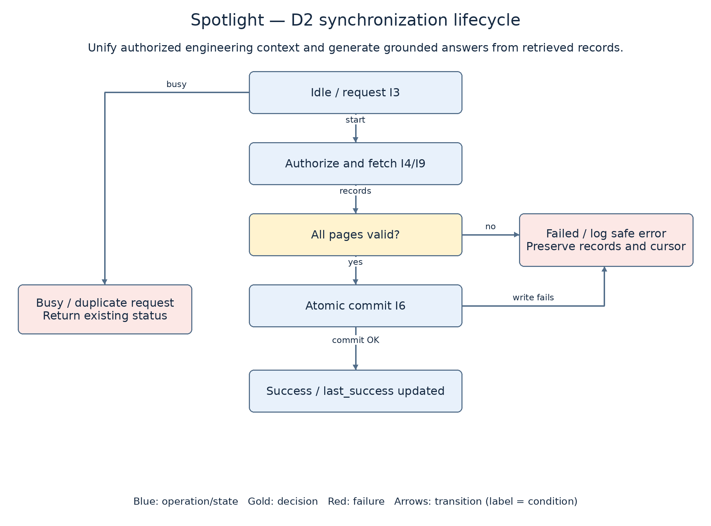
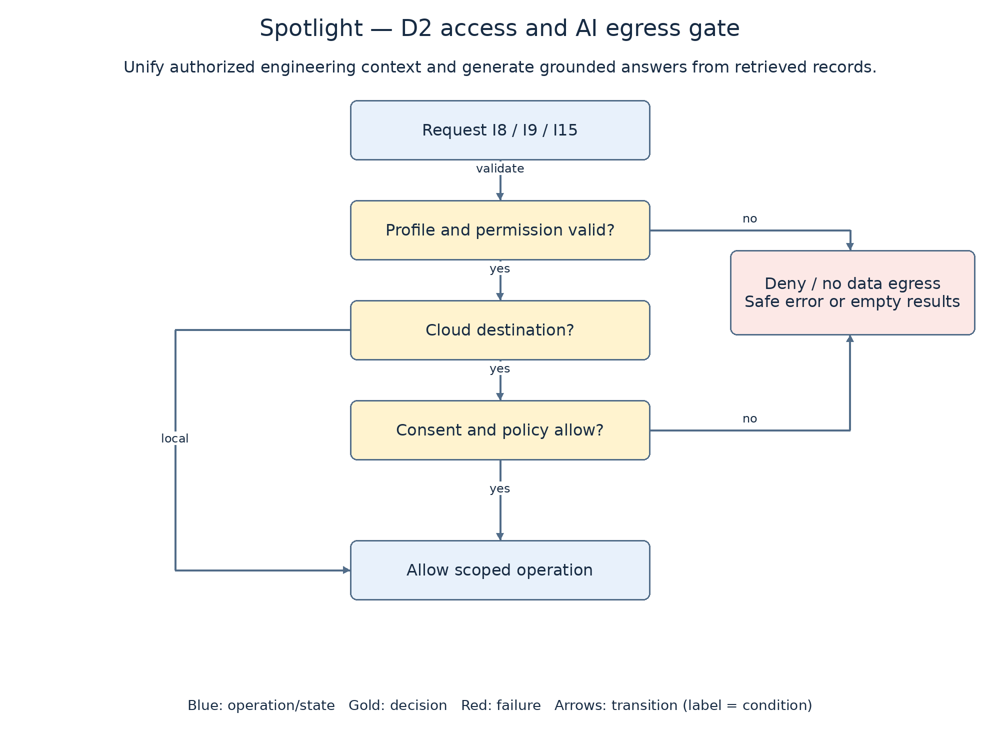

# Spotlight — D2 Detailed System Design

**Team:** Shashwat Mishra, Rohan Shetty  
**Advisor:** Dr. Hrishikesh Vinayak Bhide

## 1. Header, conventions, and D2 overview

**Goal:** Unify authorized engineering context and generate grounded answers from retrieved records.

Spotlight is a single-user desktop application for searching authorized Git, pull request and issue records. Electron/React communicates with a local Go service; SQLite/FTS5 stores records; optional RAG generates cited answers using a configured local Ollama runtime or explicitly approved cloud provider. D1 detailed C2, C6 and C7. D2 completes C1, C3, C4 and C5, including configuration, credentials, error reporting and logging, and audits all seven components. No paid hosting is required. Figures use blue operation boxes, gold decision boxes, red failure boxes and labeled directed transitions. These are proposed designs, not implementation or test results.

**Known gaps:** A concrete remote issue-tracker vendor, provider/model, hardware benchmark, dependency/license audit and stakeholder validation remain open. GitHub issues and PRs plus local Git are the proposed initial sources; other trackers are deferred. Actual peer feedback has not been supplied. AI requirements below are proposed additions to US-03; no peer review or approval is claimed. Remote permission freshness is bounded by the policy below, not instantaneous revocation. Exact OS vault integration remains to be tested.

## 2. Finished components, the D2 diagrams

### C1 — Desktop interface (Rohan)

**Data model:** No persistent data owned by C1. Session state: query:string, filters:Filters, results:Record[], selectedRecord:Record?, mode:enum(search,context,sync), requestId:string, pending:bool, error:Error?, consent:bool (per AI request), activeProfile:string. C6 owns persistent source configuration; no secrets or prompts are stored by C1.

**Behavior B1:** Start local backend on loopback with a random per-launch token; keep token in Electron main process, expose only narrow validated IPC methods to renderer. Validate query, dispatch I2 or I12 with request ID, show pending state, discard stale responses after a new query, render text as plain text, present error or empty state. AI is separate and optional; no automatic cloud fallback. For I11, open only a returned authorized source reference after rechecking access; allow HTTPS to configured source hosts or canonical paths inside approved repo roots; reject shell commands, arbitrary schemes and traversal. Display sync status without blocking search. Provide keyboard navigation and labeled controls (proposed usability refinement).

**Interfaces:** I1 desktop actions as D0; I2 and I12 use D1 endpoints unchanged; I3 sync/status below; I11 OpenSource(sourceRef:string) -> opened:bool, error:Error? (INVALID_SOURCE_REF, ACCESS_DENIED, OPEN_FAILED). C1 handles failures visibly. IPC accepts only these named actions, not arbitrary URLs or filesystem operations. C1 resolves AI citations via C2 authorized lookup; an unresolved reference is displayed as unavailable, not opened.

### C3 — Synchronization service (Shashwat)

**Data model:** Uses D1 Source (cursor, last_success) and SyncRun (run_id, source_id, status, count, completed_at, error_code); no additional persistent entity. In-memory per-source mutex, run deadline and staged canonical Record[]; one active run per source. Status enum idle/running/success/failed; count = records inserted or changed, not pages fetched.

**Behavior B2:** Validate source ID and session, acquire source lock, report running, fetch pages via I4 from last committed cursor, validate records and deduplicate by (sourceId,id), stage without changing committed data. Limit each MVP run to 10,000 records; reject overflow without committing. Recheck authorization before I6. Commit records, references, FTS and cursor in one SQLite transaction; update last_success only on success. No-change run commits status with count zero. On auth failure stop immediately, mark source authorization unverified, preserve records/cursor, record safe failure via status-only I6. On transient timeout/429 retry at most once only if Retry-After and remaining deadline allow; otherwise fail. A 60-second target applies to 100 records under normal API conditions; a 60-second hard run deadline bounds the prototype. Release lock on every exit. If failure logging itself fails, surface STORE_WRITE_FAILED from memory and local safe log; never report success. Interrupted runs are marked failed on restart.

### C4 — Source adapters (Shashwat)

**Data model:** No persistent data. Adapter input: sourceId:string, cursor:string?, deadlineMs:int; transient source configuration from C6, credential from C5. Output canonical D1 Record[] and nextCursor:string?. Local Git and GitHub API adapters proposed; source-qualified identity and configured project namespace prevent cross-repo ID collision.

**Behavior B3:** Resolve configured source, call I9 before reading, validate local path or configured HTTPS endpoint, read only commits/files or remote PR/issue records. Walk pages with bounded deadline; normalize timestamps to UTC RFC3339, type, title, body, original reference and explicit work-item IDs. Reject malformed required fields; treat optional missing body as empty string. Preserve source-specific stable IDs, reject mismatched source IDs and repeated cursors; no mutation calls or shell interpolation. Map provider errors to shared error codes. Local Git uses read-only commands with fixed argument arrays; remote API uses read-only authenticated HTTPS and validated redirects. Credentials never enter returned records.

**Interfaces:** I4 Fetch(sourceId:string,cursor:string?) -> records:Record[],nextCursor:string?,error:Error? (SOURCE_NOT_FOUND, INVALID_RECORD, AUTH_FAILED, RATE_LIMITED, SOURCE_UNAVAILABLE, CURSOR_INVALID). I5 read operation, repo/path, cursor, transient credential -> raw records and optional HTTP status; Git subprocess exit or HTTP 401/403/429/5xx maps to typed errors. C4 owns mapping, C3 owns retry/rollback. I9 defined below.

### C5 — Access control (Shashwat)

**Data model:** Uses D1 Profile and Source. Proposed configuration fields owned by C6: source approval state enum(approved,denied,unverified), lastVerifiedAt:timestamp?, permittedCloudProviders:string[], credentialRef:string?; provider config {providerId:string, kind:enum(local,cloud), endpoint:string, enabled:bool, credentialRef:string?}. Secrets in OS vault only. No extra user accounts or shared workspaces. Authorization cache is in memory; reset on restart.

**Behavior B4:** Validate per-launch session and profile match. Default deny unknown or revoked sources; local sources require approved canonical root and OS read permission. For remote sources, require a successful permission check within the preceding 5 minutes; on expiry, explicit denial or auth/network failure, suppress cached records until reverified. Refresh on sync/explicit reconnect; no network call is required for ordinary local search. Recheck before result delivery and navigation. A cloud model requires per-request consent AND approved repository destination policy; if any record is denied, abort entire model call. Use approved provider endpoint and scoped credential via I10; no automatic cloud fallback. Model response is untrusted text and has no tool access. External revocation can remain unknown within the 5-minute window; this is a deliberate bounded exposure gap to validate with repository owners.

### Interface completion and glue

All local HTTP routes use D1 /api/v1, JSON UTF-8, loopback and launch token. IDs are nonempty strings up to 256 characters; timestamps UTC RFC3339. Error = {code:string,message:string}; messages exclude private content and secrets. Internal methods use Go typed structs. I3 uses one request/response envelope for sync and status; status calls do not start sync. I6–I8 and I12–I15 retain D1 contracts. The following refinements complete D0 rather than renumbering it.

| Interface / method | Input | Output | Error and handler |
|---|---|---|---|
| I3 POST /api/v1/sync | sourceId:string, action:enum(sync,status) | 200 {status:enum(idle,running,success,failed),count:int,completedAt:timestamp?,lastSuccessfulAt:timestamp?,error:Error?} | 400 invalid action; 401 session; 403 denied; 404 source; 409 busy (existing status); 503 store/source failure; C3 returns safe state, C1 displays. |
| I4 C4.Fetch | sourceId:string,cursor:string? | records:Record[],nextCursor:string?,error:Error? | C4 maps read/validation errors; C3 aborts staged batch. |
| I5 source read | operation:enum(read),repo/path:string,cursor:string?,credential:string? | raw records:list,status:int? | C4 maps native failure or HTTPS status; never writes source. |
| I9 C5.AuthorizeRead | profileId:string,sourceId:string,requestedScope:enum(read) | allowed:bool,credential:string?,error:Error? | ACCESS_DENIED or VAULT_UNAVAILABLE; C4 stops. |
| I10 Vault | profileId:string,credentialRef:string,operation:enum(get,set,delete); secret:string only for set | credential:string? (get only),outcome:enum(ok,missing,failed) | C5 fails closed; never logs credential. |
| I11 OpenSource | sourceRef:string,action:enum(open) | opened:bool,error:Error? | C1 rejects unsafe path/URI or denied source; reports OS errors. |
| I8 C5.AuthorizeSources | profileId:string,candidateSourceIds:string[] | allowedSourceIds:string[],error:Error? | Unknown/expired sources excluded; policy failure denies all. |
| I15 C5.AuthorizeContext | profileId:string,providerId:string,recordIds:string[] max 10,consent:bool | allowedRecordIds:string[],allowed:bool,credentialRef:string?,error:Error? | C5 denies any unapproved record/destination; C7 stops. |

**Configuration:** C1 provides source setup/reconnect actions under I1; C3/C5 use a proposed additional local method POST /api/v1/sources with {action:enum(add,reconnect,disable),sourceId:string,kind?:enum(local_git,github),locator?:string,credential?:string}. Add requires kind/locator; reconnect may supply a new secret; disable revokes source immediately. Return {sourceId:string,status:enum(approved,denied,unverified),error:Error?}; 400 invalid locator, 401 session, 403 denied, 503 vault/store failure. C5 writes secrets to vault, C6 stores references only. Provider setup uses analogous local configuration with approved endpoint, kind and policy; no renderer access to secrets after entry. New setup methods are proposed adjuncts to I1/I3/I9/I10, not changed D0 links; team should confirm this refinement before implementation.

**Logging and notifications:** C3 records run status in SyncRun; local structured application logs use {timestamp,component,operation,errorCode,requestId} only, with proposed 5 MiB rotation and two retained files. No bodies, tokens, prompts or private paths. C1 displays in-app error/status messages; no external notification service. If logging fails, retain visible error and continue safe operations; database failure is surfaced, not silently ignored.

**D1 audit:** C2 uses A1 and I2/I7/I8/I13; C6 uses D1 ERD and I6/I7; C7 uses A2 and I12–I15. All remain unchanged except proposed clarifications: start a bounded read transaction per search; qualify citations by source ID; use a direct authorized ID lookup internal to C2 (I7/I8) for citation resolution, rather than fuzzy search. C6 schema additions above are proposed D2 configuration fields, not a rewrite of the D1 record model. No D0/D1 files are modified.

## 3. Edge cases and error handling

Every row specifies the handler, outcome and recoverability. B = boundary; T = timing/concurrency; I = bad/missing input; X = external dependency.

| ID | Component | Category | Edge case | Design decision / handler / recoverability |
|---|---|---|---|---|
| E1-B | C1 | B | Empty results | Show zero matches, not error; C1; yes |
| E1-T | C1 | T | Old response arrives after new query | Discard stale request ID; C1; yes |
| E1-I | C1 | I | Unsafe source URI | Reject navigation; C1; yes |
| E1-X | C1 | X | Backend or OS opener unavailable | Show unavailable, offer restart; C1; yes |
| E2-B | C2 | B | 0 matches or >50 default | Return empty or capped ranked results; C2; yes |
| E2-T | C2 | T | Concurrent sync | Read committed snapshot, enforce deadline; C2/C6; yes |
| E2-I | C2 | I | Empty or invalid query | 400 INVALID_QUERY; C2; yes |
| E2-X | C2 | X | Index unavailable | 503 and safe log within 5 s; C2; yes after repair |
| E3-B | C3 | B | 0 updates or >10,000 staged | Zero success or reject overflow; C3; yes |
| E3-T | C3 | T | Duplicate sync or deadline | 409 busy / abort after deadline; C3; yes |
| E3-I | C3 | I | Unknown source / invalid batch | Reject and retain cursor; C3; yes |
| E3-X | C3 | X | Auth failure or rate limit | Stop auth; retry transient once within budget; C3; yes after reconnect |
| E4-B | C4 | B | Empty page or looping cursor | Finish empty end page; reject repeated cursor; C4; yes |
| E4-T | C4 | T | Slow page / cancellation | Cancel read at remaining deadline; C4; yes |
| E4-I | C4 | I | Missing required record field | Reject batch, map INVALID_RECORD; C4; yes after correction |
| E4-X | C4 | X | Git path missing or API unavailable | Return SOURCE_UNAVAILABLE; C4; yes |
| E5-B | C5 | B | No allowed sources | Return empty set; C5; yes |
| E5-T | C5 | T | Permission expires during retrieval | Recheck before output/egress; deny if stale; C5; yes after refresh |
| E5-I | C5 | I | Wrong profile or no cloud consent | Deny, no model call; C5; yes if approved |
| E5-X | C5 | X | Vault or permission API unavailable | Fail closed; C5; yes after recovery |
| E6-B | C6 | B | Duplicate composite ID | Upsert stable key and refs atomically; C6; yes |
| E6-T | C6 | T | Concurrent write / busy database | Bounded busy wait then rollback; C6; yes |
| E6-I | C6 | I | Invalid record/FK | Reject transaction; C6; yes |
| E6-X | C6 | X | Disk full / corrupted index | Rollback; surface error; rebuild only with authorization; C6; conditional |
| E7-B | C7 | B | Zero evidence / >10 records | NO_CONTEXT or cap ten; C7; yes |
| E7-T | C7 | T | Provider exceeds 30 seconds | Cancel request, MODEL_TIMEOUT; C7; yes |
| E7-I | C7 | I | Unknown citation or prompt injection | Reject invalid references; no tool execution; C7; yes |
| E7-X | C7 | X | Model unavailable / rate limit | Return failure; preserve search; no cloud fallback; C7; yes |

## 4. Requirements traceability table

Priority: M = must-have; S = should-have optional AI extension. Requirements are planned, not verified. Existing IDs preserved; additions marked proposed. Timing tests use approved synthetic/public fixture data on the target workstation.

| Requirement | Priority | Specific design element | How / edge and figure / gap |
|---|---|---|---|
| US-01 unified search | M | A1, I2, FTS5 | Rank authorized cross-source records; E2-B/I/X; D1 ERD. |
| US-02 original context | M | B1, I11, Record.sourceRef | Open validated reference; E1-I/X. |
| US-03 explicit relationships | M | A1, WorkItemReference | Match project-scoped explicit IDs; E2-B; D1 ERD. |
| US-04 sync failure diagnosis | M | B2, I3, SyncRun.error_code | Report status and reason; E3-X; D2 sync figure. |
| US-05 authorized data | M | B4, I8/I9/I15 | Fail closed and suppress denied data; E5-B/T/I/X; D2 access figure; revocation window remains. |
| AC-01.1 search within 2 s / 10,000 | M | A1, I7, FTS5 | Test known matching set within requested limit, required fields; E2-B/T; D1 ERD. Larger sets require future pagination. |
| AC-01.2 empty within 2 s | M | A1, I2 | Empty array plus UI message; E1-B/E2-B. |
| AC-01.3 unavailable index within 5 s | M | I7, I2, safe logging | Error, unchanged config; E2-X/E6-X. |
| AC-02.1 100 records within 60 s | M | B2, I6, Source.last_success | Atomic upsert, count and timestamp, searchable records; E6-B/T; D2 sync figure. |
| AC-02.2 no changes | M | B2, I6 | Zero updates/no duplicates; E3-B/E6-B. |
| AC-02.3 auth failure within 5 s | M | B2/B3, I9, SyncRun | Fail and preserve records/cursor; E3-X/E5-X; D2 sync figure. |
| US-03 AI extension (proposed) | S | A2, I12–I15 | Context answer with cited evidence; E7-B/I/X; D0 AI and D2 access figures. |
| AC-03.1 AI answer or explicit failure within 30 s (proposed) | S | A2, I14 | Bounded context and deadline; E7-T; model choice/benchmark open. |
| AC-03.2 no relevant evidence (proposed) | S | A2/I13 | No_context and zero provider calls; E7-B. |
| AC-03.3 denied cloud consent (proposed) | M if AI enabled | B4/I15 | Zero cloud calls, ACCESS_DENIED; E5-I; D2 access figure. |
| AC-03.4 invalid citation (proposed) | S | A2/I14 | Reject unknown cited ID, no answer shown; E7-I. |
| NFR-01 $0 recurring infrastructure | M | Local SQLite, loopback service | No mandatory host or paid AI; optional cloud fees excluded unless approved; D0-01/08. |
| NFR-02 read-only and authorized test data | M | B3/I5/I9 | No mutation paths, authorized fixtures and license check; E4-I/X; D0-03. |
| NFR-03 local privacy and credential safety | M | B4/I10, safe logs, C6 | OS vault, no secret in records; E5-X; vault test pending. |
| NFR-04 two-person semester scope | M | D0-02, bounded adapters, C7 optional | No multi-user/cloud hosting; feasibility review pending. |

**Reverse coverage:** C1 B1 supports US-01/02/04; C2 A1 supports US-01/03/05; C3 B2 supports US-04 and AC-02; C4 B3 supports US-01/03/04 and NFR-02; C5 B4 supports US-05 and NFR-03; C6 ERD/I6/I7 supports US-01/03/04 and NFR-01; C7 A2 supports proposed US-03 extension. Configuration serves US-04/05, logs AC-01.3/02.3. No unrelated notification or account service is introduced. AI is an explicit proposed requirement extension, not claimed stakeholder validation. Accessibility refinement remains an unvalidated design goal.

## 5. Design rationale

No entries are marked peer-review-driven because no review evidence is available. The following decisions extend D0-01 through D0-09 and require team confirmation.

**R-01.** We chose SQLite/FTS5 over hosted PostgreSQL because single-user indexing needs no host. We accepted the trade-off of local-only storage because privacy and cost outweigh shared workspaces.

**R-02.** We chose keyword BM25 RAG over mandatory embeddings because exact identifiers matter and FTS already exists. We accepted the trade-off of reduced semantic recall because a bounded MVP can be tested first.

**R-03.** We chose atomic staged sync over partial page commits because AC-02.3 requires old data preserved. We accepted the trade-off of higher temporary memory use because rollback is simpler for bounded batches.

**R-04.** We chose source-qualified record IDs over global external IDs because IDs collide across sources. We accepted the trade-off of longer keys because duplicates and citations must be unambiguous.

**R-05.** We chose five-minute permission freshness over trusting cached records indefinitely because revocation matters. We accepted the trade-off of remote records can disappear offline and revocation is not instantaneous because fail-closed behavior is preferable to indefinite exposure.

**R-06.** We chose OS credential vault over plaintext configuration because tokens must not enter index/logs. We accepted the trade-off of platform-specific integration effort because confidential records require protection.

**R-07.** We chose local loopback HTTP with launch token over public backend because local installation fits the budget. We accepted the trade-off of extra process lifecycle work because standard REST tooling supports both developers.

**R-08.** We chose bounded optional LLM over mandatory cloud inference because privacy and ordinary search must survive outages. We accepted the trade-off of limited context and possible no-answer outcomes because source-grounded responses and no mandatory spend matter.

**R-09.** We chose plain-text rendering and constrained source opening over arbitrary model-generated links/actions because untrusted engineering text must not trigger execution. We accepted the trade-off of less interactive output because safe verification is more important.

## 6. Peer design review notes

External peer review evidence is pending. See [Peer_Review_Notes.md](Peer_Review_Notes.md) for the separate record and proposed internal follow-up. No review team names, feedback, participation, or review-driven changes have been invented. The highest-feedback criterion and the two issues raised while reviewing other teams cannot be determined from the available information.
